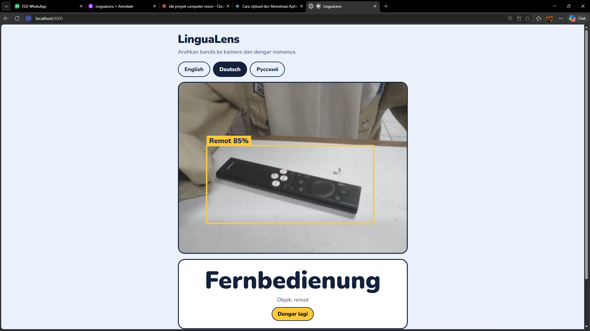

# LinguaLens

**Arahkan, Dengarkan, Hafalkan.**

LinguaLens adalah website belajar kosakata bahasa asing berbasis kamera. Pengguna memilih bahasa (Inggris, Jerman, atau Rusia), mengarahkan sebuah benda ke kamera, lalu sistem mengenali benda tersebut, menampilkan katanya, dan mengucapkannya.





## Latar belakang

Belajar kosakata hanya dari buku teks sering terasa membosankan bagi pelajar, terutama anak-anak. Kata-kata terlepas dari benda nyata, dan pelafalan sulit dipelajari dari teks saja. LinguaLens menghubungkan benda di sekitar pengguna dengan kata dan suaranya.

## Fitur

- Pilihan bahasa: English, Deutsch, dan Русский
- Deteksi objek langsung dari kamera (tanpa perlu memotret)
- Kata tampil besar di layar dan diucapkan lewat file audio
- Tombol "Dengar lagi" untuk mengulang pelafalan
- Daftar "Kata yang sudah ditemukan"
- Penahan agar suara tidak berulang-ulang (objek harus stabil dan ada jeda cooldown)
- Suara cadangan dari browser jika file audio tidak ditemukan

## Cara kerja

```
Kamera (browser)
      │  frame gambar
      ▼
 index.html ──► server.py ──► Roboflow Workflow (model deteksi objek)
      ▲              │
      └──────────────┘  hasil: nama kelas, misalnya "Botol"
      │
      ▼
 words.json  →  kata dalam bahasa pilihan  →  audio/<bahasa>/<kelas>.mp3
```

1. Browser menangkap frame dari kamera dan mengirimkannya ke `server.py`.
2. `server.py` meneruskan gambar ke Roboflow, lalu mengembalikan hasil deteksi.
3. Nama kelas yang terdeteksi dicocokkan dengan kamus di `words.json`.
4. Kata ditampilkan dan file audio sesuai bahasa diputar.

`server.py` diperlukan karena browser memblokir pemanggilan langsung ke Roboflow (aturan CORS). Server juga menjaga API key tetap berada di sisi server, bukan di kode website.

## Teknologi

| Bagian | Teknologi |
|---|---|
| Deteksi objek | [Roboflow](https://roboflow.com) (model dilatih sendiri, dipanggil lewat Serverless Cloud API) |
| Antarmuka | HTML, CSS, JavaScript murni |
| Backend | Python (library standar, tanpa instalasi tambahan) |
| Audio | [gTTS](https://pypi.org/project/gTTS/) (Google Text-to-Speech) |
| Font | [Nunito](https://fonts.google.com/specimen/Nunito) (Google Fonts) |

## Struktur folder

```
lingualens/
├── index.html           # halaman web (tampilan dan logika)
├── config.js            # pengaturan deteksi (ambang, cooldown, dll.)
├── server.py            # menyajikan web dan meneruskan gambar ke Roboflow
├── words.json           # kamus kata (en, de, ru) per kelas
├── generate_audio.py    # pembuat file MP3 dari words.json
└── audio/
    ├── en/              # contoh: botol.mp3
    ├── de/
    └── ru/
```

## Prasyarat

- Python 3.8 atau lebih baru
- Laptop dengan webcam
- Browser modern (Chrome atau Edge disarankan)
- Koneksi internet (untuk deteksi ke Roboflow dan untuk membuat audio)
- Akun Roboflow dengan model deteksi objek yang sudah dilatih dan di-deploy

## Instalasi dan menjalankan

### 1. Unduh project

```bash
git clone https://github.com/USERNAME/NAMA-REPO.git
cd NAMA-REPO
```

### 2. Siapkan model di Roboflow

1. Buat project **Object Detection**, unggah foto, beri label, lalu latih model.
2. Buka halaman model, klik **Deploy Model**, pilih **Cloud API** lalu **HTTP / cURL**.
3. Salin URL workflow dari contoh cURL (bentuknya `https://serverless.roboflow.com/.../workflows/...`).
4. Ambil **Private API Key** di Roboflow (Settings, lalu API Keys).

### 3. Isi server.py

Salin `URL workflow dan Private API Key` di server.py :

```
ROBOFLOW_WORKFLOW_URL=https://serverless.roboflow.com/NAMA-WORKSPACE/workflows/NAMA-WORKFLOW
ROBOFLOW_API_KEY=ISI_PRIVATE_API_KEY_KAMU
```


### 4. Sesuaikan kamus kata

Buka `words.json`. **Kunci harus sama dengan nama kelas di Roboflow** (huruf besar atau kecil tidak berpengaruh, spasi dibaca sebagai `_`):

```json
{
  "botol": { "en": "bottle", "de": "Flasche", "ru": "бутылка" },
  "handphone": { "en": "phone", "de": "Handy", "ru": "телефон" }
}
```

Nama kelas bisa dilihat di Roboflow pada menu **Classes & Tags**.

### 5. Buat file audio

```bash
pip install gTTS
python generate_audio.py
```

Skrip membuat `audio/en`, `audio/de`, dan `audio/ru`. File yang sudah ada dilewati, sehingga aman dijalankan ulang saat menambah kata baru. Langkah ini membutuhkan internet.

### 6. Jalankan server

```bash
python server.py
```

Buka **http://localhost:8000**, pilih bahasa, klik **Mulai kamera**, lalu arahkan benda ke kamera.

## Pengaturan deteksi

Diatur di `config.js`:

| Pengaturan | Fungsi | Nilai awal |
|---|---|---|
| `MIN_CONFIDENCE` | Batas minimal keyakinan model agar deteksi dipakai | `0.6` |
| `STABLE_FRAMES` | Jumlah deteksi berturut-turut sebelum kata diucapkan | `2` |
| `COOLDOWN_MS` | Jeda sebelum kata yang sama diucapkan lagi (ms) | `4000` |
| `INTERVAL_MS` | Jeda antar pengiriman frame ke Roboflow (ms) | `1200` |

Setiap frame yang dikirim memakai kredit Roboflow, jadi tutup tab saat tidak digunakan.

## Menambah objek baru

1. Tambahkan foto dan label di Roboflow, lalu latih ulang model.
2. Jika ada **kelas baru**, tambahkan kuncinya di `words.json`.
3. Jalankan `python generate_audio.py` untuk membuat audio kelas baru.
4. Jika URL workflow berubah setelah deploy ulang, perbarui `ROBOFLOW_WORKFLOW_URL` di `.env` lalu restart server.

## Pemecahan masalah

| Gejala | Kemungkinan penyebab dan solusi |
|---|---|
| Pesan `HTTP 401` atau `403` | API key salah. Periksa `ROBOFLOW_API_KEY` di `.env` |
| Pesan `HTTP 404` | URL workflow salah atau terpotong. Salin ulang dari contoh cURL |
| Pesan `HTTP 502` | Server tidak bisa menjangkau Roboflow. Periksa koneksi internet |
| Kotak muncul tapi kata tidak tampil | Nama kelas belum ada di `words.json`. Lihat pesan merah di bawah kamera |
| Kata tampil tapi tidak ada suara | File MP3 belum dibuat atau namanya tidak cocok. Jalankan `generate_audio.py`, cek volume, dan lihat tab Network di DevTools |
| Kamera tidak menyala | Beri izin kamera di browser, dan buka lewat `http://localhost:8000` (bukan membuka file HTML langsung) |
| Perubahan tidak terlihat | Muat ulang dengan Ctrl + Shift + R |

Untuk menyelidiki lebih lanjut, buka DevTools (F12) dan lihat tab **Console**. Aplikasi mencatat hasil deteksi dan kunci kamus yang terbaca.

## Keamanan

- API key hanya dibaca oleh `server.py` dari `.env` dan tidak dikirim ke browser.
- Server hanya menerima koneksi dari komputer yang sama (`127.0.0.1`) dan memblokir pengunduhan `.env` serta `server.py` lewat browser.
- Jika API key pernah terlanjur terbagikan atau terunggah, buat ulang (regenerate) di pengaturan Roboflow.

## Batasan saat ini

- Hanya mengenali objek yang ada dalam dataset pelatihan. Objek lain tidak akan diucapkan.
- Akurasi dipengaruhi pencahayaan, sudut, dan jarak kamera.
- Membutuhkan internet saat deteksi berlangsung.
- Berjalan di laptop lewat server lokal. Untuk dipakai dari HP atau internet, `server.py` perlu di-hosting.
- Kualitas suara gTTS bersifat sintetis. Pelafalan bahasa Jerman dan Rusia sebaiknya diperiksa penutur asli.


## Tim

- **Dien**: Mngumpulkan sample, membuat tampilan UI, membuat kode generate audio, tes dan evaluasi
- **Salsa**: Mengumpulkan sample, labeling, training, dan integrasi roboflow dengan web

